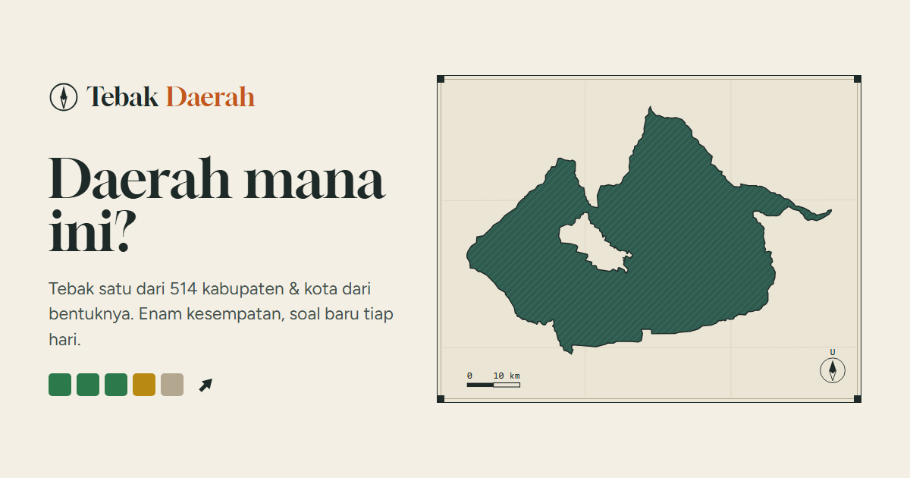

# Tebak Daerah



**[Main sekarang](https://tebak-daerah.vercel.app)**

Tebak satu dari 514 kabupaten dan kota di Indonesia dari bentuk wilayahnya. Ada enam
kesempatan; setiap tebakan yang salah memberi tahu jarak, arah, dan seberapa dekat
tebakanmu dengan jawaban.

- **Harian**: satu soal yang sama untuk semua orang, berganti pukul 00.00 WIB. Urutan
  soal diacak sekali dengan benih tetap, jadi tidak ada daerah yang muncul dua kali
  sebelum ke-514 daerah habis.
- **Bebas**: soal acak sepuasnya, bisa dibatasi per pulau.
- Petunjuk provinsi bisa dibuka setelah tiga tebakan, dan tanda *provinsi sama* muncul
  kalau tebakanmu sudah di provinsi yang benar.
- Batang skala dan mata angin di bawah bentuk memberi gambaran ukuran dan arah.
- Setelah selesai: peta letak jawaban dan tebakanmu, luas wilayah, upah minimum 2026
  (dari proyek [UMR](https://umr.raffstw.my.id)), hasil berbentuk emoji untuk dibagikan,
  serta statistik dan *streak* harian (tersimpan di peramban).

```
Tebak Daerah #1 4/6 💡
🟩🟩🟩🟩🟨➡️
🟩🟩⬜⬜⬜⬅️
🟩🟩⬜⬜⬜↘️
🟩🟩🟩🟩🟩🎯
```

## Data

Batas wilayah dari [geoBoundaries](https://www.geoboundaries.org) IDN ADM2 (sumber BPS,
WFP, OCHA ROAP; lisensi CC BY 3.0 IGO), dipadankan dengan nama baku BPS oleh proyek UMR.
`npm run data` membangun:

| Berkas | Isi |
|---|---|
| `public/bentuk/<id>.json` | Bentuk satu daerah untuk soal, disederhanakan sesuai ukurannya sendiri (maks. ~1.600 titik), dimuat hanya saat soal itu muncul |
| `public/data/peta.json` | TopoJSON kasar seluruh Indonesia untuk peta hasil |
| `src/data/daerah.json` | Nama, provinsi, pulau, titik tengah, luas, dan upah minimum |

Penyederhanaan dilakukan per daerah karena penyederhanaan global membuat kota kecil
seperti Magelang tinggal segitiga. Pengujian memastikan luas setiap berkas bentuk
tidak meleset lebih dari 12% dari luas aslinya (sekaligus menangkap arah putaran
poligon yang terbalik untuk d3-geo).

Jarak dihitung dengan rumus haversine antar titik tengah wilayah; kedekatan 0% berarti
sejauh pasangan daerah terjauh di data (sekitar Sabang–Merauke).

## Menjalankan

```
npm install
npm run dev
npm test
npm run build
```

Vite + TypeScript tanpa framework UI; peta dengan d3-geo dan topojson-client.
